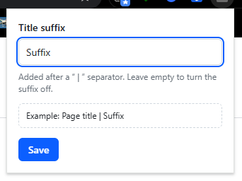

# Chrome Profile Title Suffix

Small Chrome extension that adds a suffix to every page title, so the Windows window title shows which Chrome profile you're using.

```
Inbox - Gmail | Work - Google Chrome
Inbox - Gmail | Personal - Google Chrome
```



## Why

A lot of desktop software works out what you're doing from the title of the active window. Chrome's window title is just the page title, so Gmail in your work profile and Gmail in your personal profile look exactly the same.

With a different suffix set in each Chrome profile, anything that matches on window titles can tell the profiles apart.

### Time tracking

This is what I built it for. Time trackers like Toggl Track (and ManicTime, Timing, RescueTime, ActivityWatch etc.) can assign time automatically based on the window title.

1. Use one Chrome profile for personal stuff and another one for work.
2. Set the suffix to `Personal` in one and `Work` (or your work email) in the other.
3. Add rules in your time tracker, for example:
   - title contains `| Work` = work project / client
   - title contains `| Personal` = personal project
4. Time now goes to the right project depending on which profile you were in.

It also works for anything else that targets windows by name, e.g. AutoHotkey scripts or window managers.

## Installation

It's not on the Chrome Web Store, so it needs to be loaded unpacked:

1. Download the zip from the [Releases page](../../releases) and extract it (or clone the repo).
2. Go to `chrome://extensions`.
3. Turn on Developer mode (top right).
4. Click Load unpacked and select the extracted folder.
5. Do steps 2-4 in each Chrome profile you want to tag, since extensions are installed per profile.

## Usage

1. Click the extension icon in the toolbar (you can pin it from the puzzle piece menu).
2. Type a suffix, e.g. `Work`, `Personal` or `name@company.com`.
3. Press Enter or click Save.

All open tabs in that profile update straight away and new pages get the suffix as they load. Titles end up as `Page title | Your suffix`. Save an empty suffix to turn it off.

The suffix is saved per profile (in `chrome.storage.local`), so each profile keeps its own.

## How it works

- A content script runs on all `http`/`https` pages and adds ` | <suffix>` to `document.title`.
- A `MutationObserver` puts the suffix back when a page changes its own title (single-page apps, unread counters etc.) and makes sure it isn't added twice.
- Changing the suffix in the popup updates all open tabs.
- The only permission is `storage`. Nothing is sent anywhere.

## Limitations

- Chrome doesn't let extensions run on its internal pages, so `chrome://` pages, the New Tab page, the Chrome Web Store and the PDF viewer won't get a suffix.
- Pages without a `<title>` are left alone.
- The suffix is part of the page title, so it also shows up in tabs, bookmarks and history.

## Files

- `manifest.json` - extension manifest (Manifest V3)
- `content.js` - adds the suffix to pages and keeps it there
- `popup.html` / `popup.js` - toolbar popup for setting the suffix

## License

[MIT](LICENSE)
